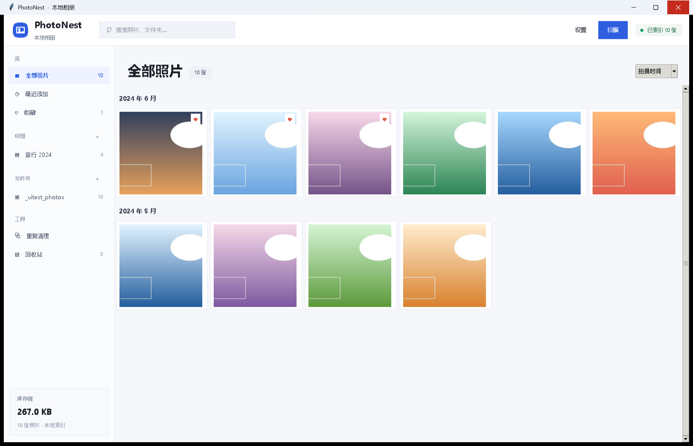
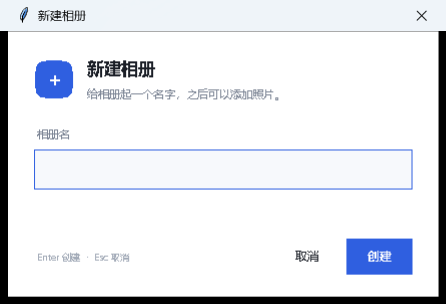

# PhotoNest

本地优先的 Windows 相册管理工具。**原生桌面窗口**，不打开浏览器，也没有本地 HTTP 服务。

首次打开即自动扫描本机固定磁盘，逐步显示发现的图片、GIF 和视频，无需手动选择文件夹。后续启动补读磁盘变更日志，运行中实时监听媒体目录。支持时间线浏览、大图查看、相册、查重复，以及中文语义搜索、自动分类和图片转文字。照片不会被上传。

原有界面截图（改版前，保留作对照）：



新建相册弹窗：



## 直接使用

1. 双击 `PhotoNest.exe`
2. 首次打开会自动扫描本机固定磁盘，优先读取图片、桌面、下载、文档等常用目录
3. 媒体会陆续出现在时间线；可随时暂停或继续。首次登记完成后在后台补齐元数据和查重，不等待全部图片解析后才可浏览
4. 扫描到图片后自动进行文字识别、语义索引和分类；无需单独开启 AI，暂停/继续会同时控制扫描与识别
5. 在「设置 → 外观」选择主题：跟随系统（默认）、浅色或深色；选择后立即生效
6. 左侧「视频」「动图 GIF」可分别浏览；GIF 在查看器中播放/暂停，视频显示封面并可调用系统播放器
7. 关闭窗口后继续在右下角托盘运行；托盘菜单可打开、暂停同步或真正退出

几点说明：

- **确认版本**：主窗口标题与设置页显示版本号和当前程序位置；本次更新包为 `PhotoNest-0.7.3-win64.zip`。项目目录中的 `PhotoNest.exe` 也会同步更新，可以直接运行；下载 ZIP 分发给别人时需要完整解压

- **`PhotoNest.exe`、`_internal`、`models` 必须放在同一目录**，请完整解压压缩包
- **数据目录**：如果程序旁已有可写的 `data`，优先继续使用该目录；否则默认 `%LOCALAPPDATA%\PhotoNest`，不可写时改用程序旁的 `data`，再不行用 `%TEMP%\PhotoNest`。设置页面里能看到实际路径
- **关闭与退出**：关闭主窗口隐藏到托盘，继续监听；「设置 → 退出程序」或托盘「退出程序」才结束进程。同一照片库重复启动会唤回已有窗口。托盘不可用时保留窗口，避免无法找回
- **SmartScreen**：exe 没有数字签名，Windows 可能提示「已保护你的电脑」，点「更多信息 → 仍要运行」
- **换电脑**：用 `PhotoNest-win64.zip`，解压后直接使用；不需要安装 Python 或再次下载模型
- **扫描范围**：「设置 → 扫描范围」可移除不需要的磁盘/目录，也可补充文件夹；顶部「扫描本机」可重新发现固定磁盘。首次运行此自动扫描版本也会为已有库补全本机范围，已有照片按增量规则跳过
- **扫描边界**：读取当前用户可访问的本地文件；默认跳过系统、软件运行库、开发依赖和缓存目录，以及目录链接、网络盘、可移动盘和仅云端的占位文件；对已识别的 QQ、微信、Steam 用户媒体分支定向扫描。专有封装或加密缓存不会被当成普通图片解码。不更改文件权限，不自动下载云端照片
- **系统和软件资源**：按目录过滤壁纸、应用图标、浏览器及已知客户端缓存。正常下载、QQ/微信附件与 Steam 截图保留。已经入库的资源会隐藏而不删除；右键照片 →「忽略所在或上层文件夹…」，可直接选当前目录、任意祖先目录或磁盘根目录，包含其全部子目录。在「设置 → 过滤与忽略」管理或恢复，恢复时仅补扫原有照片库范围。自定义路径的软件资源可能仍需手动忽略
- **统一自动处理**：顶部「扫描并识别」与托盘共用暂停/继续；后台新图片会优先加入 AI 队列，已处理且未变化的图片不重复识别。AI 页用于查看进度、恢复处理和导出文字；视频暂只建立文件索引和封面，不进行画面语义识别
- **后续启动**：立即显示已有索引，后台从保存的 USN 位置补齐退出期间的增删改名；运行中递归监听应用媒体根目录。日志缺失、权限不足或历史过期时校验受影响范围。升级到 0.7.0 会先建立一次增量基线；手动暂停会保持暂停

## 已经实现

- **统一主题**：主界面、查看器、文字识别和应用弹窗使用同一主题；默认跟随 Windows 应用主题，支持手动浅色/深色并记住选择
- **原生窗口**：圆角按钮和线性图标；自适应照片网格、按月分组、顶部搜索与扫描状态；点击搜索框外或按 Esc 可结束输入，× 可清空搜索
- **照片查看器**：滚轮或 ＋/− 缩放、拖动查看细节、100% 原始像素、一键适应窗口；右侧切换信息与文字；左右方向键切换照片，编辑文字时方向键移动光标
- **扫描与索引**：分批登记文件、复用文件状态，再补尺寸/拍摄时间和查重；变化文件优先于后台查重。缩略图及视频封面按需异步加载。外部删除与改名会核对索引，同盘改名优先保留收藏、标签与文字纠正
- **照片来源**：根据所在目录识别 QQ、微信、Steam、Telegram、钉钉、飞书、企业微信、浏览器下载、截图和相机照片；未知来源归入本地照片。实际扫描范围在设置中管理
- **多选与全选**：平时单击照片直接查看；右键 →「多选」进入选择模式，此时每张缩略图右上角显示勾选圆圈，多选工具栏中并排显示「删除所选」和「结束多选」。多选时单击增减选择，Shift+单击选择连续范围；Ctrl+单击也可直接进入多选。Ctrl+A 或「全选」选中当前分类/搜索结果的全部照片（包括未加载分页），Esc 或「结束多选」隐藏勾选控件和删除按钮；输入框中的 Ctrl+A 仍选择文字
- **右键菜单**：保留已选中的多张照片，可批量收藏、加入相册、移到系统回收站；回收站支持批量恢复和永久删除。右键未选照片时切换为该照片
- **统一菜单样式**：右键菜单复用主界面的微软雅黑 UI 字体、按钮、线性图标与主题色，支持快捷键提示、方向键导航、Esc 和点击外部关闭
- **元数据**：拍摄时间（EXIF，缺失回退文件时间）、尺寸、相机、GPS、截图识别
- **时间线**：按年月分组、分页加载、缩略图懒加载
- **大图查看**：预览图、上一张/下一张、文件信息、收藏、加入相册、定位文件、打开原图
- **相册**：新建、加入、计数；相册同时写一份 `<数据目录>\albums\<id>.json`
- **重复清理**：按内容哈希找出完全相同的文件，保留第一张、其余移入回收站
- **回收站**：删除实际移入 Windows 回收站，支持恢复原位置；清空仅永久清除 PhotoNest 记录的对应回收项目。确认照片已从当前用户可访问的系统回收站消失时，清理过期的 PhotoNest 记录；无权访问时仍保留记录。不能安全回收时取消删除；旧版仅隐藏的记录也会先通过系统回收再清除
- **清空结果核验**：Windows 返回 `0x00270008` 时，会核对本条回收文件是否确已消失；已消失则完成清理，文件仍在、操作取消、访问受拒或真正失败时保留记录。不会据此全局清空系统回收站
- **文件权限**：每次打开时统一请求 Windows 管理员授权，通过后本次运行保持管理员权限；已经以管理员身份启动时不重复请求。取消授权则退出。授权后继续使用原来选定的数据目录，不因提权切换照片库；不自动修改照片的文件权限。`--check-ai` 仅执行模型与界面自检，不请求提权
- **批量文件操作**：在后台处理并显示进度，失败项目保留记录；安全副本放在 `<数据目录>\recovery`，不在照片所在文件夹创建文件，支持照片与数据目录位于不同磁盘。Windows 没有返回有效回收记录时恢复原文件；如果原位置也无法写入，保留副本及记录原位置的 JSON，并提示具体位置。真正退出程序会在当前文件处理结束后停止剩余任务
- **搜索**：综合搜索、文字匹配、画面内容三种模式，结合文件名、路径、标签、OCR 文字和中文图文向量；语义结果按相关性排序；复用向量矩阵，图库变化时失效更新
- **自动分类**：人物、宠物、美食、风景、建筑、文档、票据等 20 类候选，可手动编辑；侧栏按标签浏览
- **图片转文字**：照片与可编辑识别文字并排显示，支持整图提取、框选识别、复制、导出 TXT、保存纠正；点击识别文字可定位原图中的对应行，修改文字后停止使用原始定位框
- **后台识别**：默认随扫描补全旧照片，增量处理新图；新增图片可优先于旧库排队，暂停与扫描同步。移除逐图固定空等，按可用 CPU 提速；已有完整内容哈希一致的重复图片复用原始识别结果，不复制其他照片的人工纠正。结果保存在本地数据库中，重启后继续使用
- **滚轮**：按鼠标所在区域滚动照片列表、侧栏、照片信息或识别文字，不受搜索框输入焦点影响
- **设置**：侧栏内独立页面，包含外观主题、扫描范围管理、统计、重新扫描、打开数据目录、退出程序；重复清理也可直接从侧栏进入
- **本地优先**：没有账号、没有遥测、不联网

## 数据放在哪

exe 模式默认使用下列位置；程序旁已有可写的 `data` 时继续使用已有目录：

```
%LOCALAPPDATA%\PhotoNest\
├── library.db          文件/目录索引、应用根、日志进度、识别文字、向量及人工纠正（请备份，删除会丢失纠正）
├── cache\              缩略图与预览图（可删）
├── albums\             每个相册一个 JSON 备份
├── recovery\           删除前的临时安全副本；恢复失败时保留副本和原位置记录
├── photonest.log       运行日志
└── photonest-crash.log 仅崩溃时出现
```

源码模式默认在 `PhotoNest\data`，结构相同。

扫描只读照片。用户确认删除时才移入系统回收站，确认清空时才永久清除对应照片。旧版 `data\trash` 中已经移走的文件不会自动处理。

“在文件夹中显示”使用 Windows Shell 的 Unicode 文件定位接口，支持中文、空格和逗号路径；打开原图优先使用系统关联，关联程序不能启动时在 PhotoNest 中按 100% 显示原图。源文件缺失或真正无访问权限时会给出文件位置和错误原因，不更改权限。

## 从源码运行

环境：Windows 10/11 x64，Python 3.10+。本次便携版使用 Python 3.13 构建。

```bat
pip install -r requirements.txt
python app.py
```

也可以双击 `run.bat`。界面使用 Tkinter，图片使用 Pillow，识图使用 ONNX Runtime、NumPy、OpenCV 和 pyclipper；源码旁需保留准备好的 `models` 文件夹。

检查：`python test_ai.py`、`python test_ai.py --models`、`python test_ui.py`。所有库操作均使用临时照片和数据库。完整操作与模型维护说明见 [离线识图指南](docs/ai-setup.md)。

## 自己打包 exe

```bat
build_exe.bat
```

脚本会：

1. 在 `_build\ai-env` 中安装运行依赖和 PyInstaller
2. 用 `onedir + windowed` 打包，并带上清单中的离线模型
3. 用候选 EXE 实际运行 OCR、框选和图文匹配自检
4. 备份旧版后更新根目录 EXE、运行库及完整 ZIP

三个原始模型已转换为部署格式，实际选择与大小见 `models/manifest.json`，验证记录见 `docs/ai-model-validation.json`。模型和运行库随 ZIP 分发，不包含原始 PT/TAR、个人照片或数据库。程序采用 onedir，运行时直接加载同目录的运行库。

## 还没有做（v0.1 的边界）

- **人物、地点**：还没有人脸聚类和地图
- **手机端 / 局域网备份**：只有 Windows
- **相似图（pHash）**：目前只查完全相同的文件
- **视频画面语义搜索 / 内嵌播放器**：当前视频支持入库、封面、文件名搜索和调用系统播放器；AI 识图仍针对图片及 GIF 首帧
- **HEIC**：Pillow 默认不带 HEIF 解码器

## 常见问题

### 启动时报 `Could not create temporary directory!`

旧版 onefile 的问题。现在改为 onedir，运行时直接从同目录 `_internal` 加载，不再需要临时目录。确认 `PhotoNest.exe` 和 `_internal` 在同一文件夹即可。

### 启动时报 `PermissionError: [WinError 5] ... PhotoNest`

默认数据目录不可写。程序会自动降级到程序目录的 `data` 或 `%TEMP%\PhotoNest`；设置里能看到实际路径。如果三个位置都不可写，用 `--data D:\某个可写目录` 启动。

### 窗口没有出现

- 看数据目录里的 `photonest.log` 和 `photonest-crash.log`
- Tkinter 需要真实桌面环境；远程/无桌面会话可能无法显示窗口
- 用 `PhotoNest.exe --data D:\PhotoNestData` 可以指定一个确定可写的数据目录

### 杀毒软件报毒

PyInstaller 打包的未签名 exe 偶尔会被误报。添加信任，或者直接用源码运行。

## 说明

- 这是一个自用工具，没有账号、没有遥测、没有联网依赖。
- 数据库损坏或想重来：先退出程序，删掉数据目录里的 `library.db` 和 `cache`，重新扫描。磁盘上的照片不受影响。
- 61 MB 的 `PhotoNest.exe` + `_internal` 建议打包成 `PhotoNest-win64.zip` 放 GitHub Releases，而不是直接提交进仓库。
